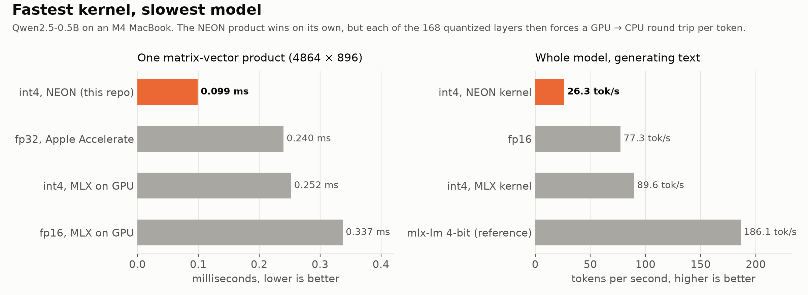
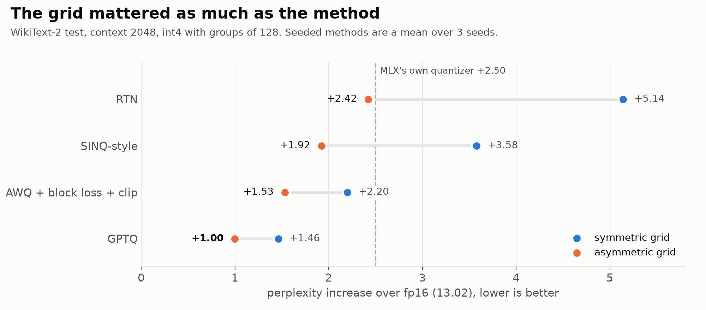

# siliconfer

**A 4-bit LLM inference engine for Apple Silicon, built from scratch: the quantizers, a CPU kernel, a GPU kernel and the decoder.**

---

"Just quantize it to 4 bits" is common advice. This project builds every piece needed to see what that really does
to a model: **GPTQ**, **AWQ** and two calibration-free quantizers, a **C++/NEON** int4 kernel, a **Metal** attention
kernel, and a decoder with KV cache and speculative decoding. Everything is measured on **Qwen2.5-0.5B** on a 16 GB
M4 MacBook.

## In short

| | |
|:---:|:---|
| **+1.00** perplexity | Cost of the best 4-bit setup (GPTQ, asymmetric grid) over the fp16 model's 13.02. Plain rounding costs +5.14. |
| **2.1×** smaller | Weights go from 988 MB to 463 MB. Not 4×, because the embedding layer stays in fp16. |
| **26.3** tok/s | The hand-written CPU kernel is the fastest single product, yet the full model runs about 3× slower than fp16 with it. |
| **3 cases** | Where packing the weights silently changed them after quantization. Each one is now covered by a test. |

  

---

## How it started

Quantization stores each weight as one of 16 levels (4 bits) plus one scale per group of 128 weights, instead of a
16-bit number. The quality cost is measured with **perplexity**: how surprised the model is by real text, lower is
better.

Before any quantization, the decoder was checked against Hugging Face `transformers`: both give the same perplexity on
the whole WikiText-2 test set to within 2.7 × 10⁻⁷. Then came the simplest method, **RTN** (round each weight to the
nearest level). Memory dropped from 988 MB to 463 MB, and perplexity went from 13.02 to 18.16.

## One weight broke the model

The first calibration-free quantizer was **HQQ-style**: for each group, it searches the clip range that minimizes the
rounding error, with no data needed. The first version was allowed to trim up to 30% of the extreme values. It passed
every synthetic test, then completely broke the real model.

The cause was a single weight in an early `down_proj` layer, far outside the rest of its group. It is what Yu et al.
call a *super weight*: rare, huge, and critical to the model. Clipping it destroyed the output. Looking at the weights
alone, there is no way to tell such a weight from a harmless outlier; that takes information about the activations,
which a calibration-free method doesn't have.

The fix was to clip only values extremely far from the median. As a result, the HQQ-style quantizer now lands at
almost the same perplexity as plain asymmetric rounding (15.43 vs 15.44). It is kept as a calibration-free option, not as an improvement.

## Packing is quantizing too

Quantizers output *fake-quantized* weights (quantized, then turned back into floats). To serve them, these weights are
packed into 4-bit codes, and packing rounds again. If a weight isn't exactly on the grid the packer uses, it silently
changes. That happened three times:

| Case | What went wrong | Fix |
|:---|:---|:---|
| Asymmetric grids (HQQ-style) | packed with the symmetric packer | an asymmetric packer and kernel |
| Per-column scales (AWQ, SINQ-style) | the weights were quantized a second time | the column scale is kept apart and applied to the input |
| GPTQ | the packer rebuilt the grid from the weights; 1.7% of groups in the first three layers got re-rounded | GPTQ hands its own grid to the packer |

Each case now has a test comparing the packed layer with the quantizer's own output. Details are in
[`docs/packing.md`](docs/packing.md).

---

## The grid mattered as much as the method

**GPTQ** rounds column by column and pushes each error onto the columns left. **AWQ** protects the channels with
large activations before rounding. Each ran on two grids: *symmetric* (levels centered on zero) and *asymmetric*
(one extra zero-point per group, +0.25 bits per weight).

  

Switching the grid alone halved the cost of plain rounding (+5.14 → +2.42), and asymmetric rounding even beat
default AWQ on a symmetric grid (15.44 vs 15.83). Best setup: GPTQ asymmetric at **+1.00**, ahead of MLX's own quantizer (+2.50).

## Fastest kernel, slowest model

The hand-written NEON kernel is 2.4× faster than Apple's Accelerate on one matrix-vector product. Yet the full model
crawls at **26.3 tok/s** against 77.3 for fp16.

The reason: the rest of the model runs on the GPU, so each of the 168 quantized layers forces a GPU-to-CPU round trip
on every token. The same 4-bit codes on MLX's GPU kernel reach 89.6–99.3 tok/s. mlx-lm's 4-bit model is still about
twice as fast (186.1 tok/s).

On the way, a sneaky bug: RoPE built its tables in float32, which silently turned the whole "fp16" model into a
float32 one that converted every weight on every call.

## A Metal kernel for the KV cache

Storing the KV cache in int8 cuts its memory from 25.2 to 13.4 MB at 2,048 tokens, for +0.68 perplexity. A Metal kernel
reads that int8 cache directly. The first two versions were slower; the third, tiled like flash attention, beats
"convert, then attention" from 4,096 tokens on (1.04–1.10×), but never beats attention on a plain fp16 cache.

---

## What didn't work

- **Speculative decoding** keeps the exact output distribution (chi-square test, 20,000 samples), but with a 4-bit copy as draft it
  runs at 0.82× normal speed.
- **A trained draft head** (EAGLE-3 style) guesses the next token 23.3% of the time vs 39.7% for the model. Too weak.
- **Mixed precision**: 5 blocks at 3 bits gives 17.96 vs 14.97 at uniform 4 bits, for a model only about 5% smaller.

## Lessons

- **Check against a reference first.** Matching `transformers` to 2.7 × 10⁻⁷ is what made every later number
  trustworthy.
- **Packing is a quantization step.** Test the packed layer itself against the quantizer's output.
- **A fast kernel is not a fast model.** Measure end to end; the cost was in the data moving between kernels.
- **Never mix perplexities from two protocols.** Context length and windowing change the numbers.
- **Weights alone can't reveal a super weight.**

## Next

- A decode loop that stays on the CPU, so the NEON kernel stops paying for GPU-to-CPU copies.
- A packed 3-bit format, to serve mixed precision for real.
- A better draft head, then wire it into speculative decoding.
- A second, larger model, where reading weights should dominate the per-layer overheads.

---

All numbers come from files in `results/`; [RUNBOOK.md](RUNBOOK.md) regenerates them.
